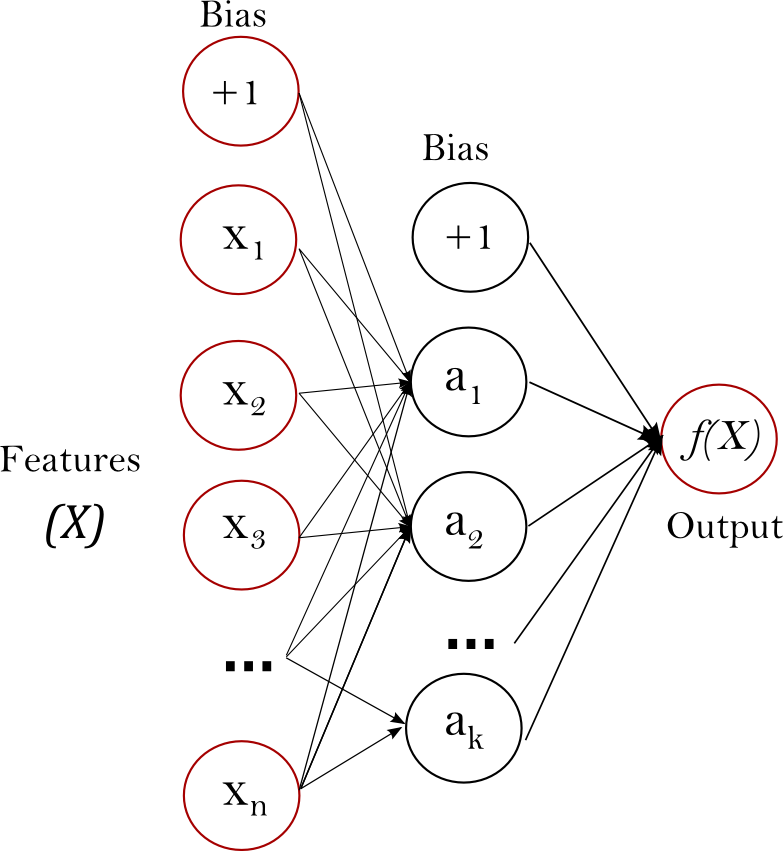

# MIIA: Aprendizaje Profundo, PEC 1



El [perceptrón multicapa (MLP)](https://scikit-learn.org/stable/modules/neural_networks_supervised.html#multi-layer-perceptron).

- [x] Construir dos redes con A=3 y B=4 capas ocultas.
- [x] Para ambas redes crear dos versiones con diferentes números de neuronas en las capas ocultas. Comparar y analizar los resultados.
- [x] Para las redes A y B con mejores resultados del apartado anterior cambiar el factor de LearningRate y comparar los resultados con los obtenidos en el apartado 2.

> :memo: **Nota:**
>
> - Realizar un procedimiento para la búsqueda del learning rate apropiado.
> - Dibujar la función de pérdida.
> - Usar early-stopping.


## Configuración

Para instalar el entorno en local, necesitas tener instalado [`uv`](https://docs.astral.sh/uv/).

```bash
uv sync
```